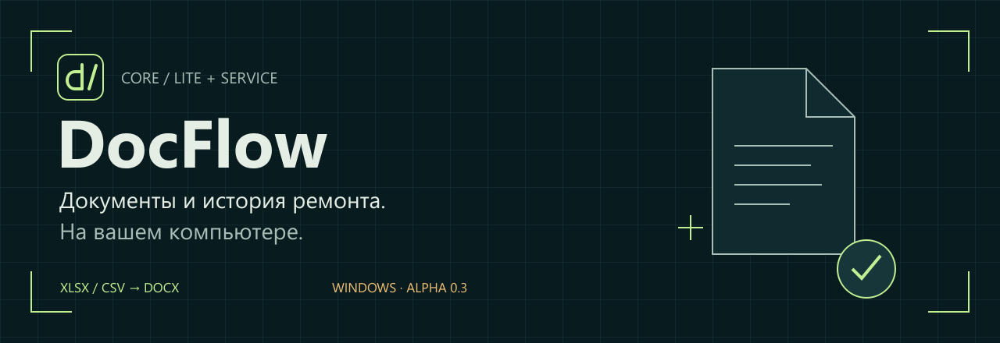
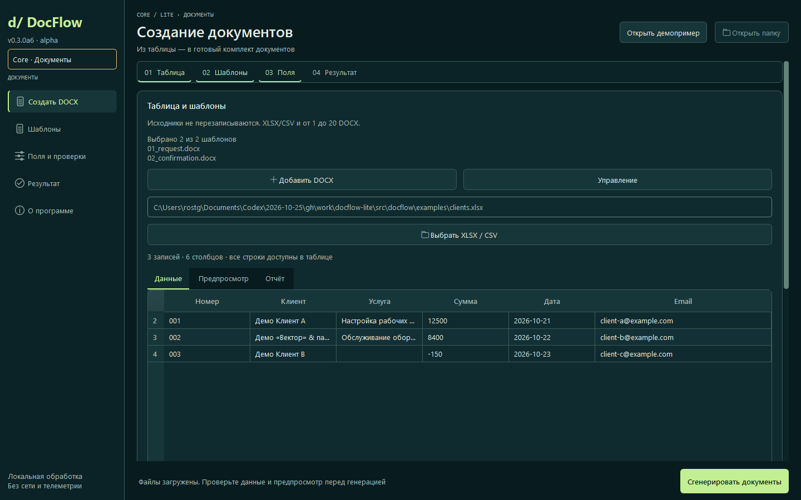
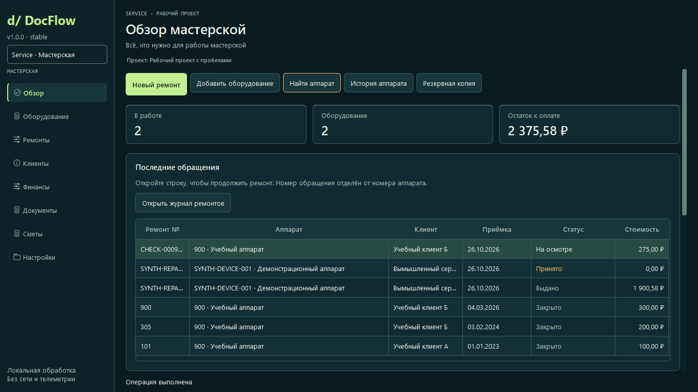

[Скачать для Windows](https://github.com/hothuman/docflow-lite/releases/download/v1.0.0/DocFlow-Lite-1.0.0-Windows-x64-Portable.zip) · [Сайт](https://docflow-lite.pages.dev/) · [Начать работу](docs/service/28_QUICK_START.md) · [Документация](docs/README.md)

# DocFlow Core / Lite + Service

Локальное приложение для повторяющейся работы с документами и историей ремонта. **Core** создаёт DOCX из XLSX/CSV и ваших шаблонов. **Service** ведёт клиентов, аппараты, отдельные обращения, сметы и документы в проекте SQLite.

**[1.0.0 опубликована](https://github.com/hothuman/docflow-lite/releases/tag/v1.0.0) — стабильный выпуск.** Программа бесплатна для личной и деловой работы по [условиям использования](LICENSE.txt). Индивидуальная настройка — отдельная услуга. Один оператор, локальные данные, без аккаунта и телеметрии.

RC1 принят владельцем в Windows/Word без замечаний. Итоговый Portable заново собран из main и проверен отдельно; точная база и SHA — в BUILD-INFO и [отчёте выпуска](docs/release/V1_PUBLISHED.md). Предыдущая a6 сохранена в истории. Коммерческий маршрут данных и условия услуг остаются отдельными незакрытыми задачами.

## Выберите задачу

Ветка этапа3 готовит **приватный кандидат 1.0.1rc6** поверх Stage2: файловый каталог XLSX/CSV, подтверждаемый перенос в смету и необязательная настройка стартовых действий. Это не обновление публичной1.0.0 и не прямая интеграция с1С. [Единая приёмка всех трёх этапов](docs/customer-projects/CLINTEK_STAGE3_HANDOFF.md), [контракт выгрузки](docs/customer-projects/CLINTEK_STAGE3_FORMAT.md), [трекер](docs/customer-projects/CLINTEK_STAGE3_TRACKER.md). Реальная выгрузка ожидается; ручная приёмка Stage2/3 открыта. Исследовательский парсер3C находится отдельно и в Portable не включён.

| Core / Lite | Service |
|---|---|
| Таблица → шаблоны → поля и проверки → предпросмотр → комплект DOCX | Клиент и аппарат → обращение → расчёт → документы → история |
| Повторяющиеся документы из строк XLSX/CSV | Оборудование, ремонты, версии смет и ручной учёт оплат |
| Сохраняемый профиль для повторного запуска | Локальный проект с вложениями и проверяемыми копиями |

Посмотреть Service

## Первый запуск Windows

1. Откройте [Releases](https://github.com/hothuman/docflow-lite/releases) и выберите нужный предварительный выпуск. v0.1.1 содержит только Core; актуальная 1.0.0 включает Core + Service.
2. Скачайте Windows x64 Portable и сравните SHA256 с манифестом **того же выпуска**.
3. Распакуйте весь ZIP. Папка _internal должна оставаться рядом с DocFlow-Lite.exe. Перед запуском ознакомьтесь с LICENSE.txt.
4. Начните со встроенного Core-демо либо отдельного Service-демопроекта. Не используйте реальные клиентские данные для знакомства.

Windows 10 1809+ / 11 x64. Python пользователю Portable не нужен. EXE не подписан; отсутствие предупреждений SmartScreen не гарантируется.

Демо Core: **4 DOCX, 2 обработанные и 1 пропущенная запись**. Ошибка намеренная. Предпросмотр текстовый; вёрстку результата проверяйте в Word/LibreOffice.

[Руководство](docs/USER_GUIDE.md) · [Обновление и откат](docs/UPDATE.md) · [Решение проблем](docs/TROUBLESHOOTING.md)

## Перед обновлением

Сделайте проверяемую резервную копию. Новую программу распакуйте отдельно и сначала откройте копию проекта. Для отката используйте прежнюю программу и проект из копии до обновления. Программа не шифрует базы, документы и архивы; доступ к папкам контролирует пользователь.

## Возможности и границы

Core поддерживает простые переменные {{поле}}, сопоставление, проверки, профили, генерацию и отчёт. До 5000 записей, 100 столбцов, 20 шаблонов и 20 МБ на входной файл. Формулы Excel отклоняются; после изменения исходника загрузите его заново.

Service поддерживает историю отдельных обращений, черновики и версии смет, ручные согласования, точные суммы, оплаты/возвраты, вложения, документы, импорт и backup/restore. Запись оплаты не перемещает деньги и не заменяет кассовый чек.

Сетевой многопользовательский режим, облачная синхронизация, банк, касса, склад и ЭДО не реализованы. Совместимость с любой формой не обещается. Alpha не означает приёмку документов конкретного заказчика.

[Полные ограничения](docs/LIMITATIONS.md) · [Адаптация заказчика](docs/CUSTOMER_ADAPTATION.md) · [Roadmap](ROADMAP.md)

## Настройка под вашу работу

Core и Service бесплатны по условиям поставки. Можно настроить их самостоятельно либо согласовать индивидуальную работу: простой DOCX от 5 000 ₽, до трёх из одной таблицы от 9 000 ₽; Service оценивается по задаче.

До заказа фиксируются входные материалы, объём, результат, цена, срок и приёмка. Для первого обращения достаточно описания без клиентских данных. [Telegram](https://t.me/de1grace) · [docflow.lite@gmail.com](mailto:docflow.lite@gmail.com).

## Разработка и проверки

Исходники: Python 3.11–3.14; Windows-рецепт закрепляет CPython 3.14.10 x64 и зависимости с SHA256.

~~~powershell
py -3.12 -m venv .venv
.venv\Scripts\python.exe -m pip install -e ".[gui,dev]"
.venv\Scripts\python.exe -m docflow.gui
.venv\Scripts\python.exe -m pytest -q tests site/tests
~~~

CLI: python -m docflow demo --out ./docflow-output. Для встроенного примера код 2 означает ожидаемые ошибочные записи, 1 — ошибку файлов/настроек, 0 — отсутствие ошибок данных.

CI проверяет Windows/Linux, GUI и браузер. Готовый EXE распаковывается и запускается отдельно от исходников. **Конкретные результаты и происхождение — в отчёте и BUILD-INFO выбранного выпуска.** Старый зелёный отчёт не подтверждает будущий commit.

[Инструкция разработки](docs/DEVELOPMENT.md) · [Изменения](CHANGELOG.md) · [Выпуск](docs/OFFICIAL_RELEASE.md)

## Поддержка и права

[Сообщить об ошибке](https://github.com/hothuman/docflow-lite/issues/new/choose) · [Поддержка](SUPPORT.md) · [Уязвимости](SECURITY.md) · [Работа с исходниками](CONTRIBUTING.md)

© 2026 Гапоненко Ростислав Дмитриевич. У оригинального продукта собственные [условия](LICENSE.txt); открытая лицензия MIT/GPL на него не назначается. Сторонние библиотеки сохраняют свои права: [THIRD_PARTY.md](THIRD_PARTY.md). Выпуск содержит уведомления, лицензии и соответствующие исходники зависимостей.

Сайт не принимает оплату и заявки, аналитика и индексация выключены. Юридические проекты услуг/обработки данных остаются отдельными от условий программы.

Portable 1.0.0 построена из `ea2ed3ad5a515ee32dce611f5bdef177141b5eb8`; [выпускной CI](https://github.com/hothuman/docflow-lite/actions/runs/40357372433) прошёл. Portable SHA256: `7a6aaef4270845f0df3018c9ccc71ff631215cf126c1ab8f04478625fcf18bf1`. Последующие изменения сайта/документации не заменяют неизменяемые файлы этого выпуска.
