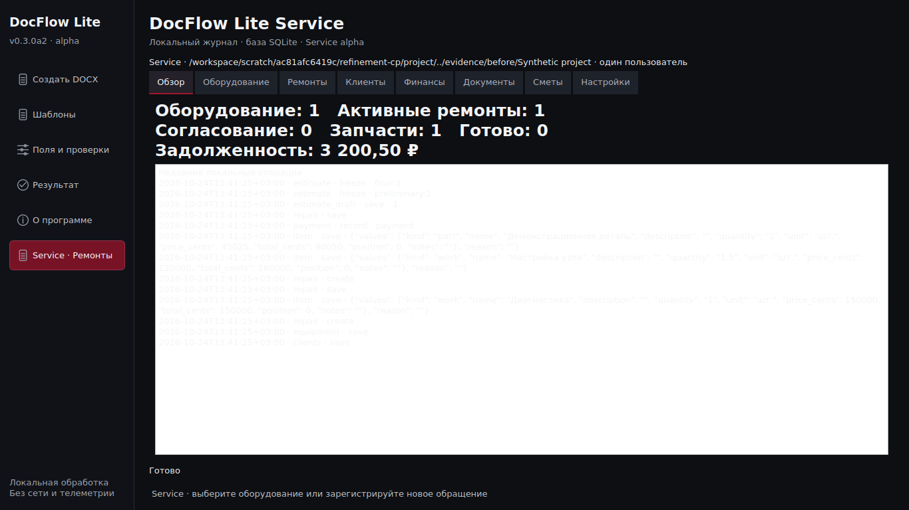
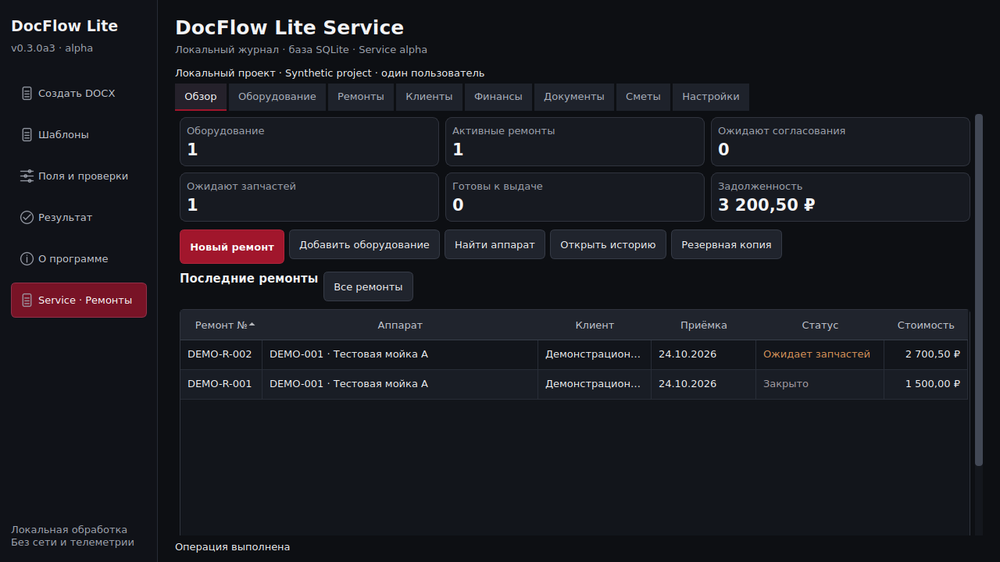
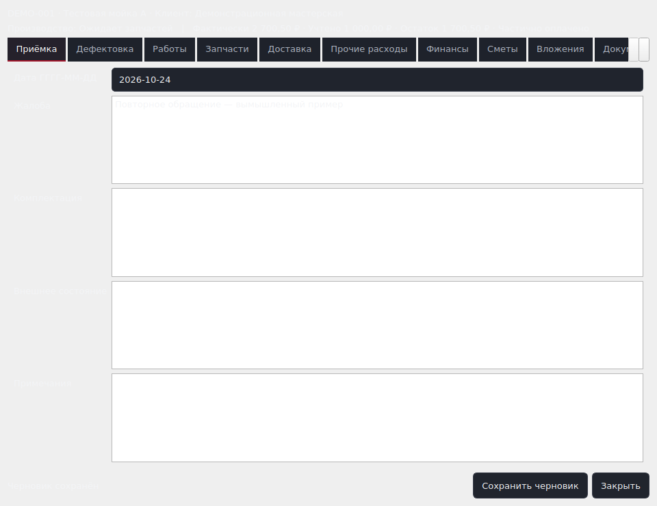
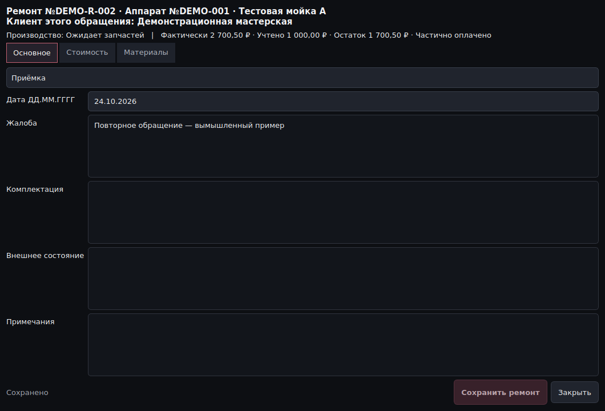
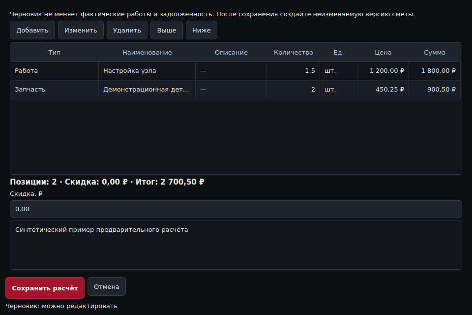
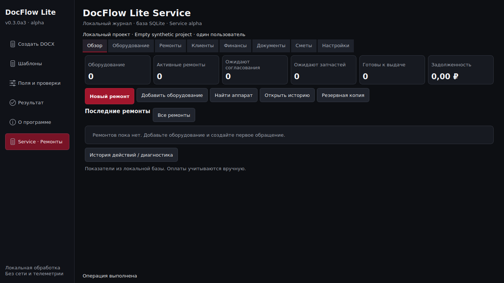

> Исторический срез предыдущей итерации. Текущее состояние и приёмка изменений a4: [единый трекер](27_PRODUCT_TRACKER.md) и [краткое руководство](28_QUICK_START.md). Результаты прошлых сборок не переносятся автоматически на a4.

# Core и Service UI UX refinement

24.10.2026. Работа в существующем Draft PR №5, исходное состояние `71e65eea`, первая сохранённая часть CP5 `ca972e78`. Это техническая alpha 0.3.0a3 для ручной приёмки. Production, официальный Release и юридический PR №4 не менялись.

## До и после

Снимки «до» повторно получены из исходного кода 71e65eea на синтетическом проекте; это не Windows-скриншоты владельца. «После» — настоящие окна Linux/Qt 0.3.0a3, без макетов и дорисовки.

| До | После | Код и проверка |
|---|---|---|
| Большое поле сырого аудита, JSON | Шесть показателей SQLite, последние восемь ремонтов, открытие строки, реальные быстрые действия | `ui/service/dashboard.py`, `refinement_check.py`, GUI regression |
| Светлый фон и светлый текст в диалогах | Общая тема приложения, диалогов, прокручиваемых форм и редакторов | `ui/theme.py`, `theme.qss`, тест фактического цвета пикселей |
| Одиннадцать вкладок с маленькими стрелками | Основное / Стоимость / Материалы, полные названия подразделов | `navigation.py`, `repair_editor.py` |
| Цена/итоги уходили вправо | Адаптивные ширины, приоритет денежных колонок, полные tooltips, локальные настройки пользователя | `widgets.py`, `models.py` |
| Нет итога черновика, неясны версии | Цена и сумма строки, итог/скидка, явные черновик и immutable версии, предупреждение при отмене | `estimates.py` |
| Большие промежутки в коротких формах | Поля начинаются сверху; подтверждение и отмена закреплены снаружи прокрутки | `forms.py`, Qt geometry regression |
| Технические исключения в основном интерфейсе | Различимые ошибки доступа/файлов/конфликта; traceback в ограниченном локальном логе | `diagnostics.py`, GUI negative tests |

## Core

Сохранена прежняя последовательность XLSX/CSV → шаблоны → поля/проверки → DOCX → результат. Общие токены распространяются на все окна. Упорядочена вертикальная компоновка настроек. CP2 перенёс интерактивную запись профиля в worker и исключил старый успешный результат при неудачном новом запуске. 29 релевантных Core GUI-регрессий после последней правки — passed. Защитный renderer не ослаблялся.

## Service и Dashboard

Показатели и список получаются из SQLite. Повторный тяжёлый запрос ремонтов при одном refresh заменён использованием того же снимка для журнала, финансов и Dashboard. Долг считается только по фактическому расчёту. Пустые проекты не заполняются демо автоматически; карточки показателей не растягиваются на всю высоту. При узком окне быстрые действия доступны через «Ещё действия», а навигация Service — через читаемый список разделов. Технические события вынесены в отдельную диагностику и переводятся только там, где журнал достоверно позволяет определить событие.

## Таблицы и история

Даты отображаются ДД.ММ.ГГГГ, денежные значения — 9 670,00 ₽. Ввод дат преобразуется в ISO перед backend, хранение не менялось. Числовая сортировка использует исходные копейки. Поиск включает русские подписи и содержательные скрытые поля, но исключает случайные UUID/JSON. Второстепенные колонки при сжатии доступны в tooltips и карточке. Пользовательские ширины сохраняются локально. История показывает жалобу, дефектовку, позиции и доступ к материалам старого обращения.

## Сметы и сохранение

Редактируемый черновик отделён от неизменяемых версий. Предварительная сумма, факт, разница, учтённые оплаты и остаток подписаны отдельно. Отметки согласования явно ручные. Порядок позиций сохраняется, итог вычисляется точной backend-арифметикой. Состояния: несохранённые изменения → сохранение → сохранено либо ошибка; конфликт не подменяет введённый текст и не показывает успех. Нажатие кнопок не отправляет сообщения клиентам.

## Сообщения и доступность

Ошибки показываются в интерфейсе; подробности локальны, автоматически никуда не отправляются. Открытие файлов проверяет возвращаемый системный результат, повреждённое изображение не выдаётся за успешный просмотр. Ввод, профили, импорт, документы, изображения и ремонт доступны с клавиатуры. Диалоги используют ограниченную начальную геометрию; длинное содержимое прокручивается, основные подтверждения остаются видимыми. Отмечено и устранено падение в комбинированном тестовом процессе: закрытые Qt-окна удаляются на GUI-потоке, QApplication живёт всю тестовую сессию; ожидания старых тестов сохранены.

## Проверки и границы

После восстановления среды: полный существующий набор **231 passed +16 subtests** до добавления новых UI-тестов. Затем **22 passed** для новых UI и прежних реальных Service-форм; **29 passed** для Core GUI. Геометрия: **450 Service +150 Core** случаев при физических клиентских размерах 1280×720, 1366×768, 1600×900, 1920×1080, 2560×1440 (Core дополнительно 3840×2160) и QT_SCALE_FACTOR 1/1.25/1.5/1.75/2. После финальных исправлений повторены релевантные тесты и 90 случаев Service. CP8 повторит весь набор и все масштабы на окончательном коде.

Визуально открыты все типы основных окон в контрольном размере, обзор/таблицы/сметы также при 175%; изображения не выданы за нативные Windows-скриншоты. Виртуальные размеры/масштабы не заменяют физические мониторы, OS DPI, нативные file dialogs и Word владельца — **NOT VERIFIED**. На малых окнах второстепенные поля требуют прокрутки/tooltip; отдельные длинные имена сокращены с доступным полным значением.

## Сайт и итоговые зависимости

Снимки и подготовительная версия должны быть обновлены на CP7, browser/Windows/Linux CI — CP8, проверка точного нового EXE — CP9. До этого новая публичная сборка не заявляется. Клиентская адаптация BLOCKED до настоящего Excel-журнала и утверждённой гарантии. Подтверждение правовых условий, merge, Release и Cloudflare требуют отдельного решения владельца.
